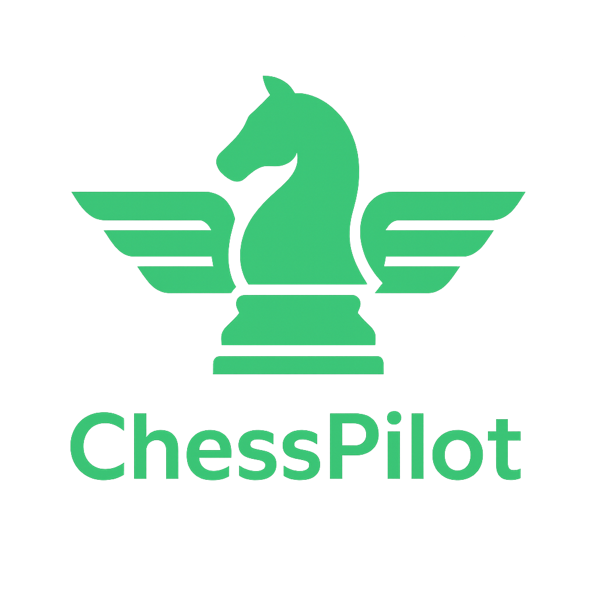
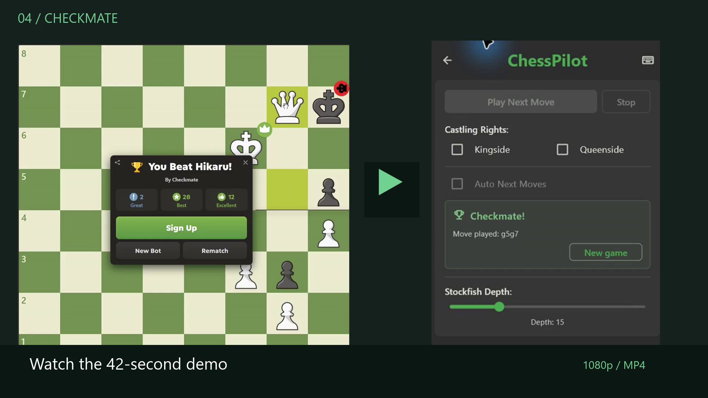

  

# ChessPilot — Offline Chess Assistant

**Chessboard detection, Stockfish analysis and move automation for Windows, Linux and Android.**

  
  
  
  

  
  
  
  

  
  
  

ChessPilot reads a visible 2D board, evaluates the position locally, and optionally plays the best move. Capture, detection and analysis run on your device after initial setup. The interface uses Flutter; Rust owns the detector, engine and automation pipeline.

Source: [Rust core and runtime](native/) · [Flutter interface](app/lib/) · [Android platform services](app/android/app/src/main/kotlin/io/github/otakuweber/chesspilot/).

---

## ✨ What's new in 3.0

- **Rust + Flutter rebuild:** native capture, in-memory ONNX detection, persistent Stockfish and move input behind a shared interface.
- **Android support:** a movable compact overlay, Play/Auto/Stop/Exit controls, guided capture/touch permissions and a phone default of depth 10.
- **Desktop packaging:** Windows setup EXE and portable ZIP; Linux portable executable, AppImage, DEB and optional `.run` installer; Android APK. Application libraries and the detector model are included. Linux supports X11 and the documented wlroots Wayland path.
- **Verified gameplay:** legal opponent-reply tracking, automatic castling-right updates, cancellable waits and clear game results. The latest fix recognizes a verified mating move when a result popup covers part of the board.

## 🎬 Demo

[Watch the full-quality video — 42 seconds, 1080p MP4](assets/chesspilot-demo.mp4). Real Windows computer-bot recordings show setup, an opening move, then the end of another game through confirmed checkmate. The middle is omitted and playback speed changes are labeled.

## ⚡ Features

- **Local analysis:** persistent ONNX detection and Stockfish, with in-memory captures.
- **Small-board recovery:** bounded refined search retries unreadable board crops before reporting an error.
- **Manual and Auto play:** Click or Drag, verified moves, legal opponent-reply tracking and cancellable waits.
- **Castling and promotions:** confirmed king/rook moves update castling controls for both colors; returning home does not restore lost rights.
- **Clear game results:** checkmate/stalemate panels, New game, and readable move errors with technical details available separately.
- **Desktop engine setup:** compact progress display, CPU-compatible official Stockfish downloads, integrity checks and reuse on later launches.
- **Phone overlay:** movable app-logo bubble, compact Play/Auto/Stop/Exit controls, touch targets and a separate settings dashboard.
- **Diagnostics:** bounded rotating logs, desktop log-folder access and Android log sharing.

The same bundled [detection model](assets/models/chess_detection.onnx.sha256) is used on every platform. Stockfish runs on the CPU. GPU acceleration is not enabled.

## 📦 Install ChessPilot

Follow the [installation and first-launch guide](docs/INSTALLING.md). It covers downloading the correct package, extracting GitHub artifacts, Windows setup/portable use, Linux sessions, Android permissions, and updating/uninstalling.

Download the app packages from [GitHub Releases](https://github.com/OTAKUWeBer/ChessPilot/releases). Development desktop packages remain available from [successful Rust + Flutter builds](https://github.com/OTAKUWeBer/ChessPilot/actions/workflows/native.yml?query=branch%3Amain). The download badge totals published release assets across all versions, including earlier releases; it does not count CI artifact downloads.

| Platform | Package | Supported automation |
| --- | --- | --- |
| Windows x64 | Setup EXE or portable bundle | Native capture and Click/Drag |
| Linux x64 | Portable executable, AppImage, DEB or `.run` installer | X11/XTEST or supported wlroots Wayland with `grim` |
| Android API 24+ | APK; source builds ARMv7 / ARM64 / x86-64 / universal | Whole-display sharing and enabled touch service |

The model ships with every platform. Desktop checks/downloads a CPU-compatible official Stockfish engine only when missing; Linux portable executables, AppImages and DEBs keep it in persistent user data, while the `.run` installation and desktop bundles keep it beside the app. Android packages its compatible engines/network. Gameplay works offline after setup.

Linux packages include Flutter, Rust, ONNX Runtime, the model and GTK dependencies. Choose AppImage or the extensionless portable executable for direct launching, DEB for a Debian/Ubuntu system installation, or `.run` for a per-user installation. The intermediate `bundle/chesspilot` executable still requires its whole bundle. See [installation](docs/INSTALLING.md) and [3.0.0 release notes](docs/releases/3.0.0.md).

Windows installers are currently unsigned and Android release-mode builds currently use the developer's local debug key. GNOME/KDE Wayland portal automation, macOS and iOS are not implemented. See [platform evidence](docs/TESTING.md) for tested cases and remaining coverage.

## ▶️ Start playing

1. Launch the Linux one-file app, install the app package, or keep the entire portable desktop bundle together.
2. Complete engine setup. On Android, enable touch control and consent to sharing the entire display; notification controls provide Stop and Exit.
3. Open an unobstructed 2D chessboard and move the app/overlay away from it.
4. Choose your color, applicable castling rights and Click/Drag mode. Start **Play Next Move** or **Auto on your turn**.
5. Use **Stop** to pause. Android **Exit** also closes the engine and ends capture. Choose **New game** after a finished game.

A screenshot cannot reveal earlier castling/en-passant history. Start on your turn with appropriate rights; after a verified baseline, legal transitions preserve the position metadata. Uncertain input is never blindly repeated.

**Android installation blocked or touch control greyed out?** Follow the separate [Play Protect installation and touch-control steps](docs/INSTALLING.md#android-installation-and-restricted-settings). Phone menu names vary; opening App info through the main Settings app list can expose a menu hidden by shortcuts.

Desktop shortcuts: **W/B** color, **P** Play, **A** Auto, **K/Q** castling rights, **←/→** depth, **Esc** Stop/change color. Before color selection, **D/C** changes move mode and **↑/↓** adjusts screenshot delay. Phone controls do not show desktop shortcuts.

## ⚙️ Engine settings and display sizes

Desktop starts new configurations with **256 MB Hash / 2 threads**; Android uses **128 MB / 2 threads**. Existing settings are preserved. Analysis depth defaults to **15 on desktop** and **10 on Android**, with selectable ranges of 10–30 and 8–30 respectively. Lower depth reduces search work and trades strength for speed.

Hash and Threads cover normal tuning. Optional strength/tablebase settings and compatibility restrictions are explained in [engine configuration](docs/ENGINE_CONFIG.md). More threads or memory do not guarantee lower total move latency.

The desktop baseline is **380×520 logical pixels**, with a **360×480 baseline minimum**. Initial sizing/minimums fit the usable monitor area; high-resolution growth is gradual. Size calculations cover 720p–8K at 100%–300% scaling. Widget checks include 320×568, 380×520 and enlarged text. These are checks of sizing/layout logic, not certification of every monitor.

Android uses density-independent sizes: a **48 dp** movable bubble and **216 dp** expanded panel, positioned within system-bar/cutout bounds. Unusual screens, foldables and additional phones still need physical testing.

## 🛠️ Build and maintain

Use [BUILDING.md](docs/BUILDING.md) for pinned SDKs, all platform prerequisites, copyable build commands and output paths. Installing a downloaded app does not require the build tools.

| Guide | Contents |
| --- | --- |
| [Installation](docs/INSTALLING.md) | Packages, first launch, permissions, updates and uninstall |
| [Building](docs/BUILDING.md) | Windows, Linux/Arch and Android source builds |
| [Engine settings](docs/ENGINE_CONFIG.md) | Defaults and optional Stockfish configuration |
| [Architecture](docs/ENGINEERING.md) | Runtime pipeline and platform boundaries |
| [Testing](docs/TESTING.md) | Checks, recorded physical evidence and remaining cases |
| [Releases](docs/RELEASING.md) | One-command version updates and distribution checks |

## 🔧 Troubleshooting and logs

- **Board not detected:** keep it visible, 2D and clear of overlays. Refinement runs automatically; an unreadably small board still fails safely.
- **Android install/touch control blocked:** see [Play Protect and restricted-settings guidance](docs/INSTALLING.md#android-installation-and-restricted-settings). Additional APK architectures do not remove these platform restrictions.
- **Capture unavailable:** check the platform capability/permission explanation. On Android, unlock and restart whole-display sharing after capture loss.
- **Engine setup fails:** use a writable app folder and a working connection, or provide a compatible offline Stockfish executable beside the desktop app.
- **Play disabled:** choose a color, finish setup, stop Auto, or choose New game after game over.
- **Need details:** open Help/Shortcuts → Diagnostics / logs. Android can share logs through its chooser.

Logs are named `chesspilot-native.log`. Windows normally uses `%LOCALAPPDATA%/ChessPilot/logs`; Linux uses XDG state/data directories; Android keeps logs private until shared. Logs rotate, and normal gameplay does not save screenshots/model tensors. Include your build, OS/device/display server, board/browser, mode/depth and relevant diagnostics when reporting a problem.

## Verification and release status

Checks cover domain rules, reference fixtures, engine failure/recovery/shutdown, actual inference, controller transitions, native buffer ownership, configuration, diagnostics, installers and platform adapters. Integration checks needing an engine, display or network are explicit opt-ins.

The build-and-tests badge covers Rust formatting, Clippy, native tests, Flutter analysis/tests, desktop builds and model inference checks on Windows/Linux. CodeFactor shows its separate static-analysis grade for `main`; a dash means a grade is not available yet. Neither badge represents test coverage or certification of every device.

Remaining release gates include production signing, clean-install/distribution review, longer memory/performance/security testing, additional monitor/phone coverage, physical phone castling/promotions/rotation/revocation cases and non-wlroots portal support. A successful build does not establish every device/runtime case. See [Android evidence](docs/TESTING.md#android-physical-device-evidence), [Linux checks](docs/TESTING.md#linux-capture-and-gameplay) and [desktop packaging](docs/BUILDING.md).

## License and acknowledgments

ChessPilot source is [MIT licensed](LICENSE). Stockfish is GPL-3.0-or-later; its license/source information accompanies packaged/downloaded engines. ONNX Runtime and Pillow-derived preprocessing retain their license notices. Review dependency/model redistribution requirements before publishing binaries.

Thanks to [Zai-Kun's 2D chess detector](https://github.com/Zai-Kun/2d-chess-pieces-detection), [Stockfish](https://stockfishchess.org/), Flutter, Rust, ONNX Runtime and the project's contributors/testers.
