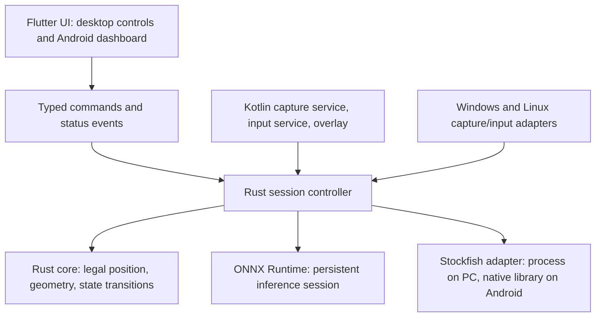

# ChessPilot: Android and PC implementation plan

Prepared 12 November 2026 against `cbe8566d39953a510e20748e6d53165a78822f91` (v2.3.1).

## Decision and scope

**Use Flutter/Dart for the interface, Rust for shared application logic and native services, and keep Stockfish and ONNX Runtime.** Start with Android ARM64 and Windows x64; preserve the current Linux X11/Wayland product before retiring Python. Other desktop architectures require their own tested artifacts. iPhone, macOS, a browser extension, accounts, cloud analysis, and a new chess engine are outside this implementation, following the clarified request for Android and PC.

The deliverable here is a plan, not an implemented rewrite. The current application, build specs, and release behavior remain unchanged. The companion [code inventory](migration-code-inventory.md) identifies every current Python function, method, class, and lambda, its source range, and its migration destination. The plan preserves the current product's features; it does not require reproducing known bugs.

The detailed [automation implementation plan](automation-plan.md) specifies replacements for Win32/PyAutoGUI, X11, existing Wayland automation, and Android gestures, including capture/input permissions, coordinate transforms, callbacks, cancellation, migration mapping and hardware acceptance tests. It is the detailed specification for the platform adapters and execution/verification phases below.

### Why this stack

| Option | Fit for this project | Decision |
| --- | --- | --- |
| Flutter UI + Rust services | One responsive phone/desktop interface; Rust owns state, inference orchestration, and desktop integration; Android still needs Kotlin platform services. | Recommended for the clarified Android/PC priority. |
| Tauri 2 + TypeScript UI + Rust | Reasonable alternative, especially if sharing web UI with an extension becomes the main goal. Custom Android capture/input plugins remain necessary. | Keep as an alternative, not a second implementation. |
| Rust-only UI | Possible, but does not remove Android service/JNI work; choosing and validating a UI toolkit becomes extra migration work. | Do not make an all-Rust codebase a requirement. |
| Flutter/Dart only | A viable smaller implementation if native bindings meet all requirements. Existing C++ inference and engine work already dominate computation. | Reconsider after the feasibility spike if Rust adds cost without measurable value; do not duplicate business logic in both languages. |
| Keep Python/PyQt | Lowest desktop migration cost, but does not provide the intended Android application or shared mobile UI. | Maintain as the reference and rollback release. |

Flutter officially supports Android and the existing desktop operating systems. Its native interop supports C-compatible FFI; `flutter_rust_bridge` is a community bridge, not a built-in Rust toolchain. Tauri also supports mobile plugins through native code. These establish feasibility, not proof that this particular app is faster in either framework. [Flutter supported platforms](https://docs.flutter.dev/reference/supported-platforms), [Flutter native interop](https://docs.flutter.dev/interop), [Flutter Rust Bridge](https://cjycode.com/flutter_rust_bridge/), [Tauri mobile plugins](https://v2.tauri.app/develop/plugins/develop-mobile/).

Stockfish remains the chess engine. ONNX Runtime already executes native inference: removing Python overhead does not automatically improve model accuracy, engine strength, or inference speed. The expected wins are fewer redundant reads, a persistent board crop, bounded work, correct cancellation, and a responsive UI.

## Evidence from the current application

Reviewed all **38 source Python files (6,136 lines)** and **6 test files (413 lines)**: **324 named functions/methods, 23 classes, and 61 lambda expressions** across 6,549 Python lines. Imports, constants, module-level initialization, main guards, comments, and UI style strings were included in the reading. Build specs, dependency/configuration files, repository documentation, templates, and CI were also inspected. Generated builds, the virtual environment, demo media, model weights, and external Stockfish machine code are not authored Python source and were not line-reviewed or decompiled.

The inventory records file hashes so these claims refer to an identifiable snapshot, not whatever a future branch contains. Enumerating symbols complements the source reading; it is not evidence that every path works on real hardware.

### Current flow

`main.py` sets DPI/app identity, configures logging, changes working directory, locates/downloads resources, creates PyQt widgets, and starts a persistent Stockfish process. A manual move starts a daemon thread. That thread captures the primary monitor, runs ONNX, builds a FEN, adds inferred castling rights, analyzes, updates predicted position state, performs mouse input, handles promotion/castling, and captures again to verify. Auto mode separately polls placement changes and invokes the same processing path.

### Baseline checked for this plan

* `venv/Scripts/python.exe -m unittest discover -s tests -v`: **32 passed, no skips** on this Windows workstation, with the local engine/model present.
* Baseline environment: Windows 11 x64, AMD Ryzen 5 9600X, Python 3.13.11, ONNX Runtime 1.20.0, Pillow 12.1.0, NumPy 2.4.1; existing CPU-provider defaults. These desktop timings are not Android estimates.
* `assets/demo.gif`, frame 0 converted to RGB, 568 x 318, current local CPU provider: model-session construction **45.26 ms**; ten warmed `predict` calls, median **20.32 ms**, maximum **23.69 ms**; ten warmed normal `get_positions` calls, median **19.45 ms**, maximum **21.18 ms**, 33 objects. These are separate noisy microbenchmarks, not evidence that the wrapper is faster than inference, a percentile estimate, or an end-to-end/phone benchmark.
* Local model: 9,897,051 bytes; input `[1,3,640,640]`, output `[1,300,6]`; SHA-256 `c5dd2f875f6f7efcc12a40ccd15bbb57158a558ac6206949c63bb804b2086c91`.
* Demo fixture SHA-256 `c4bc2a0a452bc1807abcfa5053dfcea8b2fd4e2a5484b7559ff9a7d352dfb7ce`. Local engine SHA-256 `45bc8e4969147db9c2eb533810637994619bff0eacc81ccfd9854394901bcbd0`; its exact source/build provenance still needs establishing before redistributing it.

### Issues to correct during migration

These are source findings, not a claim that every problem was reproduced in a running GUI. The three explicitly marked probes were exercised locally.

| ID | Evidence in current code | Migration requirement |
| --- | --- | --- |
| F1 | `board_detection/fen_extractor.py:86` supplies active color from the caller, and `:90` uses the same value for orientation. A local probe produces either active color from identical detections. `game/auto_play.py:313` consequently receives a supplied turn, not an observed one. | Separate player color, board orientation, and active side. Use an initial full position plus legal move history; when turn is unknown, request confirmation and prevent unattended play. |
| F2 | `core/fen_utils.py:126` onward infers rights from king/rook locations. Piece placement cannot reveal whether a king/rook previously moved. Image FEN always drops en-passant/history fields. | Preserve full position history; accept explicit initial rights and turn. Use conservative unknown metadata rather than inventing rights. Reconstruct en passant only from an established legal transition. |
| F3 | `game/move_processor.py:153` stores `updated_fen` before physical execution; the engine may also return a move with `updated_fen=None`. State is duplicated between the window and `GameState`. | Maintain one authoritative session. Separate predicted, observed, and confirmed positions. Commit only after successful verification; handle missing engine output explicitly. |
| F4 | `services/engine_service.py:251` blocks in `readline()` after checking the clock. Handshake/config/display reads also have no effective deadline. Stderr is piped without a consumer. | Use asynchronous/drained stdout and stderr with actual deadlines for handshake, ready, search, stop, and shutdown; force termination/restart after a grace period. Serialize engine ownership. |
| F5 | `_check_for_mate` retains an earlier flag; a local probe of `mate -1` followed by `cp 0` remains `True`. Result handlers display checkmate from that flag. | Store the latest evaluation separately from actual game outcome; determine checkmate/stalemate from legal position state. |
| F6 | `EngineService` calls `root.update_status` from the worker; `main.py:update_status` touches Qt labels. Worker paths also set checkboxes directly. Static `QTimer.singleShot` usage is not proof of safe main-thread delivery everywhere. Threads are daemonized without session cancellation. | UI state arrives through the bridge event stream on Flutter's UI isolate; cancellation/generation IDs suppress stale work after stop, color change, or shutdown. |
| F7 | `SKIP_VERIFICATION_ON_FAILURE=True` lets unverified moves report success. `expected_fen` is accepted but unused in normal move verification. Castling validation does not check unrelated squares; promotion discovery can mistake ordinary board pieces for a menu. | Distinguish confirmed, uncertain, and failed results; an uncertain action stops auto mode and never triggers a blind replay. Verify legal expected transitions, promotion and castling explicitly. |
| F8 | Analysis, original-position reads, verification, opponent polling, and promotion repeatedly invoke inference. Refined search adds up to nine tiles plus candidate-board passes per frame, and repeated screenshot retries multiply this. | Share frame observations and cache the last valid ROI. Bound inference count/time per observation. Reacquire on failure/geometry change, preserve raw promotion detection, and never cache a position as if it were a new frame. |
| F9 | `utils/system_interaction.py:41` captures a single primary monitor without preserving its origin; input uses global coordinates. Board geometry assumes width/8 for both axes. Random input offsets depend on `root.square_size`, which is not populated by the active position-preparation path. | Carry monitor origin, scaling, crop transforms, independent width/height, orientation, and observation ID through capture to input. Support negative desktop coordinates and clamp input to the detected square. |
| F10 | `choose_best_asset` accepts `arch` but never filters on it; a local ARM64 probe selects an x86-64 asset. Windows fallback guesses AVX2 from 64-bit architecture; the AVX2 predicate also accepts AVX alone. | Select by exact OS/ABI/architecture, then proven instruction support; default to a genuinely compatible baseline. Android uses bundled ARM64 libraries, not this desktop downloader. |
| F11 | Resources are searched/moved across working directories by several helpers. Downloader cache validity is size-based, first filename containing `stockfish` wins, and mobile-compatible native libraries are not represented. | Use one platform resource resolver, exact engine manifests and hashes, staged atomic installation, and clear errors. Retain traversal protection and test link/path edge cases. Do not relocate a user's unrelated model implicitly. |
| F12 | Wayland implementation assumes `zwlr_virtual_pointer_manager_v1`, opens a socket for each input client, and uses one `recv` for each header/payload without handling fragmentation. `grim` is not universal Wayland capture. | Use capability-negotiated portal capture/input where supported; retain a tested compositor-specific adapter only where necessary. Do not advertise all Wayland compositors based on the present implementation. |
| F13 | `core/board_utils.py:algebraic_to_index` maps invalid squares to zero or clamps them; FEN helpers do little validation. Some tests explicitly assert these fallbacks. Current king-count validation does not catch every wrong or missing non-king piece. | Use validated square/FEN types and typed errors. Port useful examples, but replace bug-preserving expectations. Keep uncertainty visible; two kings alone do not establish detection correctness. |
| F14 | The test suite has no end-to-end UI/input/capture lifecycle coverage. Engine tests look only for `stockfish.exe`, so Linux CI skips them; detector tests skip without a local model. `detect_os` returns `mac` while one test expects `macos`. | Require actual native engine/model integration jobs and hardware checks per release target. Track skips explicitly; do not label a green headless suite as platform parity. |

## Preserve the product, adapt the platform layer

| Current capability | Android implementation | Windows/Linux implementation | Acceptance evidence |
| --- | --- | --- | --- |
| Offline operation | Bundle model and engine libraries; airplane-mode runtime | Bundle model; bundled or explicitly imported compatible engine | Clean installation can analyze with network disabled; optional updates do not gate startup |
| Detect on-screen 2D board | User-approved MediaProjection foreground service, image buffers, crop/rotation handling | Selected-monitor/window capture adapter | Exact labeled FEN on agreed zoom/theme/scale corpus; unsupported/uncertain frames fail visibly |
| Pick White/Black | Touch choice, independent orientation/active-side controls | Keyboard and pointer controls | Flipped board, changed color, and changed turn do not leak previous session state |
| Play Next Move | Compact floating control while another app is foreground, backed by user-enabled AccessibilityService | Native click/drag adapter | Confirmed move on controlled local boards; duplicate requests produce one action |
| Auto Next Moves | Explicitly enabled service session; capture + input + verification; persistent stop control | Single cancellable controller | Stable legal opponent move causes one response; unknown/ambiguous state pauses |
| Drag/click | Accessibility gestures; calibrate against board bounds | Native input with tested browser drag timing | Correct source/destination through resize, scrolling, and DPI changes |
| Castling | Rules engine expected position plus platform's normal king action | Same; manual rook fallback only if target behavior needs it | Both sides/colors, already auto-moved rook, failed action, no duplicate rook move |
| Promotion | Raw detections/menu geometry, all four pieces, auto-queen verification | Same with desktop input | Queen/rook/bishop/knight for both colors; normal pieces never count as a menu |
| Depth/delay settings | Touch controls plus mobile CPU/time limits | Existing depth range and configurable delay | UI changes affect the next request atomically; persisted settings survive restart |
| Always-on-top controls | Small service-owned overlay; separate overlay access only if its implementation requires it; notification stop action | Compact always-on-top window | Overlay is excluded/masked from capture; permission denial leaves a useful analysis UI |
| Shortcuts/status/help/logs | Touch equivalents and export diagnostics | Preserve documented mode-sensitive shortcuts and logs access | All current actions have an accessible control; no keyboard dependency on phone |
| Engine setup/recovery | Packaged native libraries; no desktop executable downloading | Exact artifact install/import, restart and diagnostics | Wrong architecture, damaged file, missing NNUE, stopped engine, offline setup |

Android capture requires per-session user consent; Android 14+ requires the appropriate foreground-service declaration and cannot reuse one projection token for multiple virtual displays. Recompute geometry when the chosen app's capture dimensions change. [Android MediaProjection](https://developer.android.com/media/grow/media-projection).

AccessibilityService exposes gesture dispatch, but is a separate user-enabled service, not a permission granted by Flutter/Rust. An overlay is another distinct capability; an accessibility overlay and a general application overlay have different ownership/permission requirements. The service must own the active pipeline independently of the Flutter activity being backgrounded, and stop cleanly on capture revocation, accessibility disablement, or screen lock. [Android AccessibilityService](https://developer.android.com/reference/android/accessibilityservice/AccessibilityService).

**Distribution gate:** Google Play's current policy restricts autonomous decision-making through AccessibilityService and distinguishes it from static, rule-based automation. Stockfish-driven automatic play creates a concrete policy question; do not assume Play approval. Validate the exact product/distribution route before promising store delivery of full auto mode. This does not remove auto mode from the engineering scope: demonstrate it in the controlled Android prototype and decide distribution explicitly. Do not mislabel the app as a disability accessibility tool. [Google Play Accessibility API policy](https://support.google.com/googleplay/android-developer/answer/10964491?hl=en).

On Linux, ScreenCast/RemoteDesktop portal sessions and their compositor support must be tested together; permission denial is a supported state. [XDG RemoteDesktop portal](https://flatpak.github.io/xdg-desktop-portal/docs/doc-org.freedesktop.portal.RemoteDesktop.html).

## Proposed architecture



Use two Rust crates, not a new service framework:

```text
next/
  app/                         Flutter app and generated Android/desktop runners
    lib/                       screens, controls, settings, event binding
    android/                   Kotlin services, notification, overlay and JNI
  native/
    Cargo.toml                 Rust workspace
    core/src/                  position.rs, geometry.rs, session.rs, verification.rs
    runtime/src/               api.rs, capture/, input/, vision.rs, engine/, resources.rs
  fixtures/                    labeled frames, full FENs, engine transcripts, transitions
```

Keep the existing Python layout and specs until each platform replacement meets its gate. Do not create this scaffold as part of the planning task. No server, plugin marketplace, generic event bus, repository layer, or per-function wrapper is needed.

### Boundaries and ownership

* **Dart:** responsive screens, accessible controls, settings view, dialogs, desktop keyboard bindings, and typed bridge events. No copied move rules or second authoritative board state.
* **Rust core:** validated squares/moves/full FEN, legal transitions, separate orientation/player/active side, observed-versus-predicted positions, game outcomes, session state, and geometry transforms. It has no UI, ONNX, capture, or OS dependency and can be unit-tested on a workstation.
* **Rust runtime:** one owner of the active session, a bounded frame queue that drops superseded frames, persistent ONNX session, engine IO, ROI/reacquisition policy, verification, resources, diagnostics, and desktop capture/input adapters. No input is dispatched for an obsolete observation.
* **Kotlin/Android native code:** MediaProjection lifecycle, ImageReader/stride/rotation conversion, foreground service/notification, AccessibilityService gestures, overlay lifecycle, and calls into the native runtime. This code cannot be replaced by a Rust UI toolkit. Native buffers remain native; do not base64 full frames through Dart.
* **C++ engines:** keep Stockfish and ONNX Runtime. Desktop Stockfish stays an owned child process. Android Stockfish needs a packaged NDK/JNI or C-compatible in-process adapter with cancellation and one engine instance; do not assume a downloaded desktop executable can run on a phone.

Candidate libraries are **not yet installed or validated**: a permissively licensed chess library such as `cozy-chess` for legal board state; `flutter_rust_bridge` for Rust/Dart calls; the community `ort` binding over ONNX Runtime's native API. Pin versions only after Windows/Linux/Android compilation and runtime checks. A crate's existence is not evidence that this particular model loads on every target. If `ort` fails the Android spike, first use the official Android ONNX Runtime API behind the same inference boundary rather than writing a new inference engine. [cozy-chess source/license](https://github.com/analog-hors/cozy-chess), [ort source](https://github.com/pykeio/ort), [ONNX Runtime Mobile](https://onnxruntime.ai/docs/get-started/with-mobile.html).

### Small command/event contract

Commands: `configure`, `start_capture`, `analyze_once`, `play_next`, `set_auto`, `stop`, `export_diagnostics`. `configure` validates player color, orientation, initial position/metadata, depth/time budget, and move mode. A snapshot exposes the latest observed board/FEN confidence, engine evaluation/PV, confirmed move, active capability/permission status, and current operation. The UI does not manufacture board metadata.

Events carry `session_id`, `observation_id`, and, for analysis, `analysis_id`. Stop/color/board changes invalidate pending work. A capture frame also carries timestamp, buffer dimensions/format/stride, monitor/window identity, screen origin, scale/rotation, and ROI transform. Use opaque native handles or bounded buffers where appropriate; define ownership/freeing and callback lifetimes at the bridge. Catch native panics/errors at the boundary and report typed failures.

### Controller and chess correctness

`Idle -> Acquiring -> AwaitingStableBoard -> Analyzing -> Ready -> Executing -> Verifying -> AwaitingOpponent`.

Any state can enter `Stopping -> Idle` or `Paused(reason)`. Errors do not silently restart input. A successful screenshot is not automatically a stable legal position. Establish an initial full position or ask for turn/castling metadata; compare stable observations against legal successors. If several transitions fit, a frame skips moves, or rights/history are unavailable, pause and resynchronize. Do not use a screenshot's requested player color as turn detection.

Before an action, ensure board geometry and observed placement still match the analyzed observation. After an action, confirm the expected legal position; allow for an immediate opponent reply using known legal transitions without blindly accepting any changed board. If confirmation times out, show `uncertain`, stop auto mode, and reacquire before offering a retry. Use legal state for checkmate/stalemate; engine mate scores are evaluations.

## Performance and UI work

### Measure before promising speed

Record capture, pixel conversion, resize/tensor creation, inference, postprocessing, engine queue/search, input dispatch, verification, and UI delivery separately. Keep explicit animation/verification waits: the current 0.1-0.5 second sleeps are not all Python overhead. Compare the same model, engine build/NNUE, thread count, hash size, position, capture size, and search depth/time on each device.

The baseline above shows roughly 20 ms for a normal warmed read of one small demo frame. It does not tell us full-screen capture cost, nine-tile recovery cost, phone speed, battery cost, or how long a complete move takes. Collect those before setting a speedup claim.

Implement these optimizations in order:

1. Persistent sessions and native frame buffers; no UI-thread analysis or repeated model loading.
2. Reuse a validated board ROI while geometry is stable; send only new observations to the controller. Run expensive global search on failure, not every poll.
3. Bound normal/refined detection work and engine queues; discard stale frames. Cache geometry, not conclusions about a newly captured board.
4. Keep verification/animation delays configurable within measured safe bounds; use observations/events instead of unconditional long sleeps where reliable.
5. Benchmark CPU thread budgets so ONNX and Stockfish do not oversubscribe a phone. Select mobile hash/search-time presets from measured memory/thermal behavior; do not copy the desktop 1 GB engine hash default.
6. Only then evaluate reduced-precision models or supported acceleration providers against exact labeled FEN accuracy. Keep a CPU fallback. Do not retrain or replace the model in the first migration.

### UI acceptance, not just a different toolkit

Retain the dark/green identity. Desktop gets a compact always-on-top control window with a board preview, one Play button, prominent Stop/Auto state, evaluation, depth, and an expandable settings area. Android gets a touch-first dashboard and a minimal floating Play/Stop/status control over the target app. Keep advanced settings out of the capture/start flow.

Use responsive layouts rather than manual resolution-based window multiplication, scalable text, visible focus, screen-reader labels, sufficient contrast, minimum touch targets, and clear permission/uncertain-position states. Show capture and engine progress independently. Never display an unverified action as `Move Played`. Preserve keyboard shortcuts on desktop and provide every action by touch on Android. Do not introduce accounts or cloud setup.

Proposed release gates, to be calibrated in phase 1:

| Area | Required measurement/gate |
| --- | --- |
| Desktop responsiveness | Profile-build UI frame budget near 16.7 ms on a 60 Hz test display during inference; no analysis/capture work on the UI thread |
| Detection accuracy | Exact expected full placement on every accepted labeled frame; unknown metadata stays unknown; unreadable/ambiguous fixtures never trigger input |
| Relative speed | On the agreed Windows machine and labeled corpus, aim for at least 20% lower warmed capture-to-validated-position median than Python, with p95 no worse; if missed, investigate rather than claiming the rewrite is faster |
| Model-only cost | Same model/provider comparison; no unexplained material inference regression hidden by a faster UI |
| Android latency | Measure p50/p95 end-to-end on at least one midrange and one slower supported physical phone; set numeric budgets after the first prototype rather than inventing desktop-derived targets |
| Cancellation | Stop prevents queued new input immediately; an in-progress OS gesture is allowed to complete and is not followed by another; report stop acknowledgement and release capture/engine resources |
| Sustained use | A 30-minute auto-mode controlled-board run measures missed/double moves, memory growth, battery use, and thermal slowdown; no unbounded growth or silent unverified continuation |
| Offline | All gameplay capabilities work offline after a documented offline-capable install; no telemetry/network dependency in the loop |

## Implementation sequence

Rough effort is **12-20 developer-weeks** for an experienced developer covering Android, Windows, and existing Linux support, plus external store-review time. This is a planning estimate, not a delivery commitment. Revise it after the native-service spike. Complete each gate before expanding the rewrite.

| Phase | Work and dependencies | Acceptance gate |
| --- | --- | --- |
| 0. Inventory/baseline — completed for planning | Read current code; record snapshot, mappings, known defects, current tests and a limited inference baseline. | This plan and the complete inventory are reviewable; no production changes. |
| 1. Native feasibility — first implementation work | On Windows and a physical Android ARM64 phone, demonstrate persistent model loading, Stockfish execution/library use, cancellation, and a minimal Flutter/Rust event. On Android separately prove consented capture while UI is backgrounded, overlay positioning, and a user-enabled gesture on a controlled board. Probe GNOME/KDE portal availability before promising Linux parity. Review engine/model licenses and Android distribution. | Captured frame -> correct position -> engine move -> one verified action works on both first targets; permission revoke/stop works. Resolve the native binding and distribution questions before full UI work. |
| 2. Position core and fixtures | Build validated position/move/geometry types, independent turn/orientation, history, outcomes, and state machine. Transfer useful existing test examples and add full-position/transition fixtures. | Native core tests pass without UI/OS/inference; malformed FEN, all promotions, both-color castling, en passant, stale observations, and unknown turn covered. |
| 3. Detection/runtime | Port RGB/letterbox/tensor contract and output decoding; king validation, normal/refined search, raw promotion mode, crop transforms, ROI cache, bounded work and session reuse. Load pinned model/runtime. | Shared corpus matches adjudicated expected placements and coordinate transforms, with explicit failure cases and measured normal/refined costs. |
| 4. Windows vertical product | Complete native engine supervisor and Windows capture/input, confirmed state updates, stop/shutdown, engine import/config, existing shortcuts, and accessible compact Flutter UI. | Current desktop feature matrix passes on controlled boards and mixed-DPI/multi-monitor hardware; compare end-to-end latency with Python. |
| 5. Android full product | Move the proven capture/runtime ownership into the foreground service; complete touch UI/overlay, gesture verification, promotion/castling, battery-aware presets, rotation/app-window resize, permission-loss recovery and offline artifacts. | Physical-phone feature matrix passes, including app backgrounding, repeated capture sessions, lock/unlock and 30-minute runs. Full auto behavior is included; distribution is resolved separately. |
| 6. Linux parity | Add X11 and portal-backed Wayland capture/input; compositor-specific fallback only where tested. Package resources without relying on developer PATH or root-directory moves. | Run engine/model integration and controlled input on X11 and actual GNOME/KDE/wlroots targets; list unsupported capabilities explicitly. Do not retire Linux Python until this passes. |
| 7. Release and cutover | Reproducible release builds, pinned dependencies/model/engine, resource hashes, license/source notices, installer/APK, release diagnostics, regression/performance reports, staged user trial. | Clean-machine/phone installs work offline, all platform gates pass, rollback is documented, and legacy Python is retired only after user acceptance. |

### First implementation slice

Do **not** start by translating all 286 source functions into Rust or redesigning every screen. Build one minimal visible loop on Windows and Android: capture -> validated position -> Stockfish -> user-triggered action -> verification -> Stop. The early phone loop must include background service ownership; an image-import demo alone does not prove parity with the current app. Only after that works should the team invest in the complete UI and module migration.

## Test, fixture and packaging plan

### Fixture coverage

* Full FEN and moves: invalid rank/square/metadata, both orientations independent of turn, returned kings/rooks, en passant, all underpromotions, both-color castling, check/checkmate/stalemate, captures and immediate replies.
* Vision: labeled full-screen/cropped boards at small/normal/large zoom, high DPI, nonzero/negative monitor origins, letterbox padding, tile overlap, board-edge crop, multiple boards, themes/highlights/animations, occlusion, missing/duplicate kings, wrong non-king piece, raw promotion overlay, no-board frames, and corrupt model/load errors. Recover the earlier zoom screenshot from the user if it is not in the worktree; do not pretend it is a committed fixture.
* Pipeline: rapid Play clicks, opponent animation, geometry change after analysis, failed drag, timeout after successful input, unexpected position, stop during search/verification/input, changing color during analysis, engine crash, app close during capture, projection/accessibility revocation, service restart, screen lock and rotation.
* Install/resources: wrong ABI/instruction set, incompatible model output, unavailable provider, no internet, corrupt cache/archive, traversal/link entries, read-only installation folder, atomic update/rollback, missing engine networks, absent Linux capture/input capability.

Existing unit tests are useful seed cases, not a full oracle. Particularly replace tests expecting invalid-square-to-a8 conversion, add negative transition tests, and make integration assets explicit so Linux jobs cannot silently skip them. Capture proposed behavior changes in fixtures rather than requiring byte-for-byte reproduction of wrong historical FEN metadata.

### Checks during implementation

* Rust: formatting/lint/unit tests for the core; runtime transcript/fake-clock tests for real deadlines and cancellation; actual model and engine integration per native target.
* Flutter: analyzer, widget/keyboard/accessibility tests, integration tests of command/event flows and error states. Profile release-like builds, not debug-rendering speed.
* Android: Android instrumentation plus physical devices across the selected API support range, including current capture-consent behavior; validate native ABI/page-size compatibility with the selected NDK/runtime libraries.
* Desktop: Windows CI with installed engine/model, Linux CI with real native engine/model and a display fixture; physical multi-monitor/input/compositor sessions for release acceptance.

Use one version source per new build system, pin SDK/Rust/NDK/engine/model versions in CI, and publish exact asset hashes. Build Windows from Windows and Linux artifacts on Linux; create signed Android APK for direct installation and AAB only for an approved Play route. Pick Android minimum API from the intersection of Flutter, ONNX Runtime, native libraries, and tested devices in phase 1 rather than declaring support from Flutter's range alone.

Current `win.spec`/`linux.spec` keep building v2.3.1 during migration. Replace them only for the new product after cutover. Add native artifact jobs rather than silently changing the current Python test workflow. Linux AppImage/DEB desktop integration, icons, model libraries and licenses all need clean-install checks. Signed desktop distribution is a release decision; it is not needed to begin the prototype.

### Licensing and artifacts

The repository's own license is MIT; this does not relicense Stockfish, ONNX Runtime, UI/bridge libraries, or the ONNX model. Stockfish's upstream distribution instructions require its GPLv3 notice and corresponding source information for the exact distributed build. Android in-process linking adds a combined-work licensing question: resolve it before choosing the release license, not after writing the bridge. Verify the model's redistribution terms/provenance separately. [Stockfish source and distribution instructions](https://github.com/official-stockfish/Stockfish).

No engine source, model retraining, telemetry service, new account system, extension, or iPhone port is part of this plan. Keep engine/model upgrade work separate from porting so performance and correctness comparisons stay meaningful.

## Ready-to-start decisions and remaining evidence

Settled by the request: Android and PC; offline behavior and current automation features retained; improved UI and measured performance; extension/iPhone deferred; planning only at this stage.

Proposed defaults: Windows x64 + Android ARM64 first, Linux parity before retiring Python; Flutter/Dart UI, Rust shared/runtime code, native Android services, existing engine/model. These are recommendations, not dependencies already proven in this repository.

Phase 1 still must establish: a named physical Android test pair and minimum OS; native ONNX/Stockfish compatibility and memory budget; capture/input/overlay lifecycle; Play versus direct-install distribution for auto mode; exact engine/model licensing and source provenance; and end-to-end baseline on a labeled screen corpus. These are implementation gates, not reasons to delay the planning deliverable.

Only documentation was added for this request. No Rust/Flutter runtime, phone APK, desktop replacement, or packaged binary has been built or verified.
